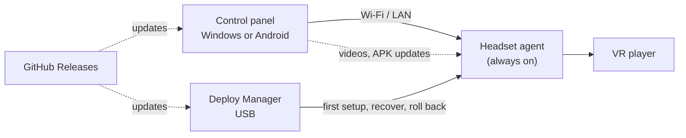

# VR Group Videoplayer

VR Group Videoplayer runs video lessons for a whole class of Meta Quest headsets. One instructor prepares the videos, sees every headset on one screen and starts synchronized playback for everyone or for a chosen group. It works on a local network without internet.

This repository is the public home for downloads, setup guides and technical reference material.

## New in 2.0

- **A new look** for the control panel and Deploy Manager: one dark, clear design for both.
- **Updates from GitHub** in both tools: the control panel updates itself and the players on every headset; Deploy Manager updates itself and downloads the newest player.
- **Deploy Manager in a window of its own** with progress per file, Recover, Reboot and **Roll back headsets**.
- **Much more stable** headsets: always connected through the agent, recovery from stuck Meta windows, the Store guard, memory fixes for long sessions and sleep/wake. See the [release notes](https://github.com/Chikanut/VR-Group-Videoplayer/releases/latest).

## Downloads

Download the latest build from [GitHub Releases](https://github.com/Chikanut/VR-Group-Videoplayer/releases/latest).

| File | Use it for |
|---|---|
| `VRClassroomPlayer-Quest.apk` | The player. Install it on every Meta Quest headset |
| `VRClassroomControlPanel-Windows.exe` | The control panel on a Windows PC |
| `VRClassroomControlPanel-Android.apk` | The control panel on an Android phone or tablet |
| `QuestDeployManager.exe` | USB tool to set up, recover and roll back headsets in bulk (Windows) |

To start, you need the player for every headset, one control panel (Windows or Android) and `QuestDeployManager.exe` for the first USB setup.

After the first install, both tools can update themselves from this page: **Settings → Updates** in the control panel, and the **Updates** section in Deploy Manager.

## What It Does

### Lesson control
- Starts, pauses, resumes, stops and seeks a video on all headsets at once, and recenters the view.
- Commands go to the whole class or only to the headsets you tick.
- Sets the volume for the whole class or for one headset.
- Plays 360° and flat 2D videos, with per-video position, crop and colour settings.
- Puts the class to sleep for a break and wakes it again over Wi-Fi.

### Always connected headsets (player 1.9.0+)
- A small agent runs inside the player's watchdog service. It stays connected while the player is closed and while the headset sleeps.
- The agent finds the control panel by itself, with no IP setup on the headsets.
- From the control panel you can open, restart or close the player on any headset.
- With autostart on, the player opens by itself after wake-up and after a reboot. You can switch autostart from the control panel, from Deploy Manager or with a 3-second pinch on both hands in the headset.

### Dashboard
- One tile per headset shows its number, status, IP, player version, battery, current video and progress.
- Class counters show how many headsets are online, playing, need attention and have their content ready.
- Filters for all, online, problem and offline headsets, plus search by number or IP.
- Tiles warn about missing videos, low battery, downloads in progress, player updates and a player that will not open.
- Headset names and numbers are stored on the headset itself and survive reinstalls of the control panel.
- Phones and tablets connect to the control panel by scanning a QR code.
- Clicking a tile opens the headset's card: rename, player and agent state, autostart, volume, seek, which videos it has, and a ping sound to find it.

### Content and setup over Wi-Fi
- **Sync content** sends the lesson videos from a folder on the PC to every headset over Wi-Fi. Files that are already there are skipped. Downloads pause while a video plays and resume after a dropped connection.
- **Update players** installs a new player APK on every headset silently, also when the player is closed. The APK can come from a local file or straight from GitHub Releases.
- **Headset environment** sets your own waiting-room look on every headset: a background colour and an optional PNG logo.
- **Headset system settings** apply Android settings to every headset when it connects, for example `global/captive_portal_mode=0` for a router without internet. Removing a line restores the headset's own value.

### Deploy Manager (USB)
- Finds every Quest connected by USB.
- Installs APKs and copies videos in bulk, with progress per file.
- Sets up the player for autostart and silent updates, and grants the permissions the agent needs.
- Applies saved Wi-Fi networks and can enable wireless ADB.
- **Recover** fixes a headset that shows only passthrough or will not open the player: it closes the stuck Meta window and starts the player.
- **Roll back headsets** returns headsets to their state before VR Classroom:
  - removes the player together with its data, permissions and autostart;
  - turns Meta's first-time setup and tips back on;
  - restores the system settings it changed;
  - optionally deletes the lesson videos and forgets the Wi-Fi networks it added.
- **Updates** downloads the latest player APK from GitHub Releases and updates Deploy Manager itself.

| Headsets over USB | Roll back |
|---|---|
|  |  |

### Updates
- **Settings → Updates** shows the panel version, the player versions on the headsets and the latest release with its notes.
- **Download and restart** updates the Windows control panel in place; **Update all headsets** sends the new player to the whole class over Wi-Fi.
- The check needs internet only on the instructor PC and can be switched off.

### One look
The control panel and Deploy Manager share one design: a dark interface with clear status colours, readable in a lit classroom and on a phone. The headset app keeps its own look.

## How It Works

1. Connect each headset to the PC by USB once and run **Deploy Manager → Deploy**. It installs and sets up the player. Step by step: [Quick Start](docs/en/quick-start.md).
2. Start the control panel on a Windows PC or Android device on the same network.
3. Add the lesson videos in **Settings → Lesson videos**, then press **Sync content**, or copy the videos over USB with Deploy Manager.
4. Open the dashboard. When the headsets show as ready, press **Play All**.

## Documentation

### English

- [Overview](docs/en/overview.md)
- [Downloads](docs/en/downloads.md)
- [Quick Start](docs/en/quick-start.md)
- [Deploy Manager: setup, recover, roll back](docs/en/deploy-manager.md)
- [Set Up the Control Panel](docs/en/setup-control-panel.md)
- [Set Up the Quest Player](docs/en/setup-player.md)
- [Prepare Videos](docs/en/prepare-videos.md)
- [Settings & Video Tuning](docs/en/settings-and-video-tuning.md)
- [Daily Use](docs/en/daily-use.md)
- [Updates](docs/en/updates.md)
- [Networking and Troubleshooting](docs/en/networking-troubleshooting.md)

### Українська

- [Огляд](docs/uk/overview.md)
- [Завантаження](docs/uk/downloads.md)
- [Швидкий старт](docs/uk/quick-start.md)
- [Deploy Manager: налаштування, відновлення, відкат](docs/uk/deploy-manager.md)
- [Налаштування панелі керування](docs/uk/setup-control-panel.md)
- [Налаштування Quest player](docs/uk/setup-player.md)
- [Підготовка відео](docs/uk/prepare-videos.md)
- [Налаштування та тюнінг відео](docs/uk/settings-and-video-tuning.md)
- [Щоденне використання](docs/uk/daily-use.md)
- [Оновлення](docs/uk/updates.md)
- [Мережа та усунення проблем](docs/uk/networking-troubleshooting.md)

## Need Help?

If headsets are not discovered:

- connect the PC and all headsets to the same Wi-Fi network or LAN, in the same subnet;
- check the Windows firewall and the router's client isolation; the headsets use ports 8000, 8080 and 8081;
- make sure each headset went through Deploy Manager once, so the player and its agent are set up.

If the tile says **Player will not open** or the headset shows only passthrough:

- connect the headset by USB and press **Recover** in Deploy Manager;
- if a headset was just rebooted and lies on the table, put it on once: Quest does not open apps until it is worn.

If a video is missing on a headset:

- set **Settings → System → Video library folder** and press **Sync content**, or copy the file to `/sdcard/Movies/` with Deploy Manager;
- enter only the file name in the control panel, not the full path.

To remove VR Classroom from a headset, use **Deploy Manager → Roll back headsets**.

See the full troubleshooting guides in [English](docs/en/networking-troubleshooting.md) and [Ukrainian](docs/uk/networking-troubleshooting.md).

## For Maintainers

- [Release checklist](docs/releasing.md)
- [Release notes template](docs/release-notes-template.md)
- [Technical player API reference](PlayerAPI.md)
- Updates from GitHub look for these asset names in the latest release: `VRClassroomPlayer-Quest.apk`, `VRClassroomControlPanel-Windows.exe` and `QuestDeployManager.exe`. Keep them unchanged. Bump `App/server/version.py`, `App/frontend/package.json` and `DEPLOY_VERSION` in `tools/quest_deploy.py` together with the release tag.
