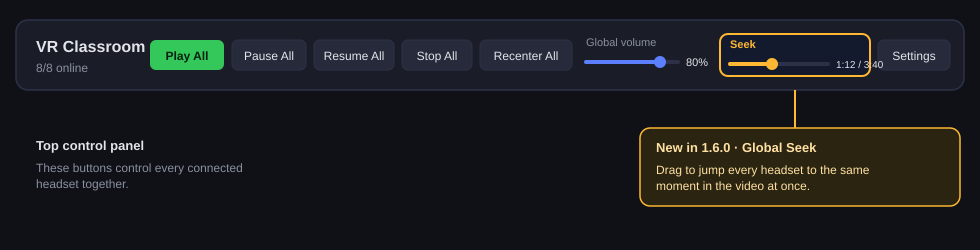
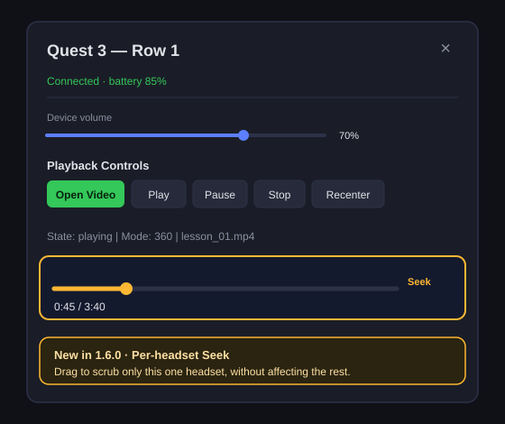

# Daily Use

## Goal

Run a normal lesson session from the control panel.

## Before Class

1. Turn on all headsets.
2. Open the player app on each headset.
3. Make sure all devices are on the same network.
4. Open the control panel.
5. Confirm every device shows as online.

## Start a Lesson

1. Open the dashboard.
2. Choose the lesson video you want to play.
3. Check whether the filename is available on the connected headsets.
4. Start playback for all devices or for one selected headset.

## During Playback

You can use the control panel to:

- play
- pause
- stop
- restart the current video
- recenter the view
- set a global volume
- adjust one headset volume separately
- **seek (jump to any moment in the video)** — new in 1.6.0

## Seek / Scrub the Video (new in 1.6.0)

You can now move playback to any point in the video — for example to skip an intro or replay a scene — without restarting.

### For all headsets at once

Use the **Seek** slider in the top control panel. Dragging it jumps every connected headset to the same moment, so the whole class stays together.

### For one headset only

Open a single headset (click its tile) and use the **Seek** slider inside the device window. This scrubs only that headset and leaves the others untouched — handy if one student needs to catch up.

> The slider follows playback on its own and shows the current time and total length (for example `1:12 / 3:40`). It is greyed out until a video is open and its length is known.

## Recenter

Use recenter if students are no longer facing the main video direction. This is especially useful for 360 content or after headsets have been repositioned.

## After Class

1. Stop playback.
2. Close the session or leave the player ready for the next group.
3. Recharge headsets if battery levels are low.
4. Update videos only when filenames are still consistent with the control panel settings.

## Expected Result

A teacher or lab operator should be able to control the full lesson without touching each headset individually.
