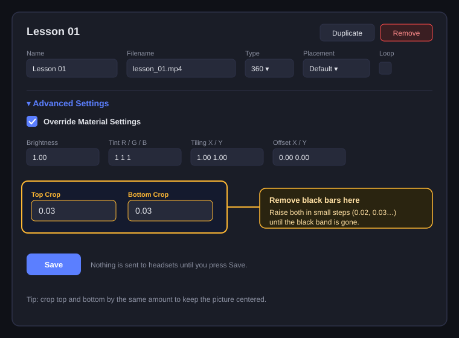
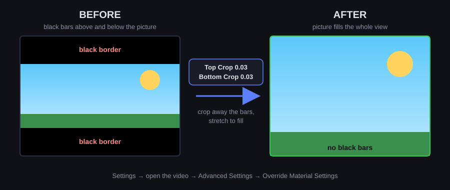

# Settings & Video Tuning

How to use the control panel **Settings** page, and how to make a lesson video look right in the headset — including removing black borders by cropping and stretching the image.

## Opening Settings

1. Open the control panel in your browser (`http://localhost:8000`).
2. Click **Settings** in the top control panel.
3. Change what you need, then click **Save**.

> Nothing is applied to headsets until you press **Save**. After saving, the next time you open a video the new settings are sent to the player.

## Settings Sections

The Settings page has four areas:

| Section | What it controls |
|---|---|
| **General** | Interface language, plus Save / Import / Export of your configuration |
| **Requirement Videos** | The list of lesson videos, their type, placement, loop, and per-video tuning |
| **System Settings** | Battery warning, network scan interval, subnet, offline timeout |
| **Footer** | App version and author info |

---

## General

- **Language** — switch the interface between Ukrainian and English. Applies immediately.
- **Save** — writes all current settings to `config.json` and pushes video definitions to players.
- **Export Config / Export Device Names** — download `config.json` / `device_names.json` as a backup.
- **Import Config / Import Device Names** — load a previously exported file. Import **fully replaces** the current data, so export a backup first.

> Use Export before every class as a quick backup, and Import to move your setup to another instructor PC.

---

## Requirement Videos

Each lesson is one row. Click **+ Add Video** to create one, **Duplicate** to copy an existing setup, or **Remove** to delete.

### Basic fields

| Field | Meaning |
|---|---|
| **Name** | A label you choose (e.g. `Lesson 01`). Must be unique. |
| **Filename** | The exact file on the headset, e.g. `lesson_01.mp4`. Filename **only** — the player opens it from `/sdcard/Movies/`. |
| **Type** | `360` for equirectangular 360 video, `2D` for a normal flat video on a virtual screen. |
| **Placement** | Where the image sits: **Default**, **Locked to camera** (follows the head), or **Free in space** (fixed in the room). Older player versions ignore this. |
| **Loop** | Restart the video automatically when it ends. |

> Names and filenames must each be unique across the list, or Save is blocked with a "Duplicate" warning.

---

## Video Tuning (Advanced Settings)

Open the **Advanced Settings** panel inside a video row to fine-tune how the image is displayed. There are two independent override groups — each only takes effect when its checkbox is ticked.

### Override Material Settings — image appearance

Tick **Override Material Settings** to control how the video texture is drawn.

| Control | Range | Effect |
|---|---|---|
| **Top Crop** | 0 – 0.49 | Cuts a fraction off the **top** of the frame and stretches the rest to fill. |
| **Bottom Crop** | 0 – 0.49 | Cuts a fraction off the **bottom** of the frame and stretches the rest to fill. |
| **Brightness** | 0 – 2 | Darker below 1, brighter above 1 (1 = original). |
| **Tint R / G / B / A** | 0 – 1 | Color multiplier. Keep at 1,1,1,1 for natural color. |
| **Tiling X / Y** | any | Texture zoom. Below 1 zooms in, above 1 zooms out/repeats. |
| **Offset X / Y** | any | Shifts the texture horizontally/vertically. Use with Tiling to reframe. |

### Override Transform Settings — image geometry

Tick **Override Transform Settings** to move, rotate, or stretch the whole video surface (mostly useful for **2D** screens and **Free in space** placement).

| Control | Effect |
|---|---|
| **Position X / Y / Z** | Move the screen left/right, up/down, closer/farther. |
| **Rotation X / Y / Z** | Tilt/turn the screen (degrees). |
| **Scale X / Y / Z** | Stretch the screen. Change **Scale X** vs **Scale Y** to change aspect ratio / fill. |

---

## How to Remove Black Borders

Black bars (letterboxing) happen when the video file has black areas baked into the top and bottom (or the aspect ratio doesn't match the display). There are two ways to fix it, depending on the video type.

### Method 1 — Crop and stretch (best for 360 and most cases)

Use this when the black bars are **part of the video image** (top/bottom letterbox).

1. Open the video row → **Advanced Settings**.
2. Tick **Override Material Settings**.
3. Increase **Top Crop** and **Bottom Crop** in small steps (e.g. `0.02`, then `0.03`…).
   - The cropped-away band is removed and the remaining image is **stretched to fill**, so the black bars disappear.
4. Save, open the video on one headset, and check.
5. Adjust until the black band is gone without cutting off important content.

**Typical starting values:** `Top Crop = 0.03`, `Bottom Crop = 0.03`. Both max out at `0.49` (you can never crop more than half).

> Tip: crop the top and bottom by the same amount to keep the image vertically centered. Use different values only if the black bar is bigger on one side.

### Method 2 — Rescale the surface (2D screens)

Use this when a **flat 2D** video doesn't fill the virtual screen, or looks squashed/stretched.

1. Open the video row → **Advanced Settings**.
2. Tick **Override Transform Settings**.
3. Adjust **Scale X** and **Scale Y** to match the video's real aspect ratio and fill the frame.
   - Widen the image: increase **Scale X**.
   - Make it taller: increase **Scale Y**.
4. Optionally use **Position Z** to bring the screen closer or push it farther.
5. Save and verify on a headset.

### Method 3 — Zoom with Tiling / Offset (fine framing)

For a subtle "zoom in past the borders" effect without cropping bands:

1. Tick **Override Material Settings**.
2. Set **Tiling X/Y** slightly below `1` (e.g. `0.95`) to zoom into the center.
3. Use **Offset X/Y** to recenter what you see.
4. Save and check.

---

## Recommended Tuning Workflow

1. Add the video with the correct **Type** (360 or 2D) first.
2. Test it **once** with default settings on a single headset.
3. Only if needed, open **Advanced Settings** and tick the relevant override.
4. Change values in **small steps**, Save, and re-open the video to see the result.
5. When it looks right, use **Duplicate** if other lessons need the same tuning.
6. **Export Config** to back up your tuned setup.

> Advanced Settings are stored per video, so different lessons can have different crop/scale values.

---

## System Settings

| Setting | Purpose |
|---|---|
| **Battery Warning Threshold (%)** | Highlights headsets below this battery level (default 20). |
| **Network Scan Interval (seconds)** | How often the panel scans for devices (5–300, default 30). |
| **Network Subnet** | Force a subnet like `192.168.1`. Leave empty to auto-detect. |
| **Device Offline Timeout (seconds)** | How long without a heartbeat before a device is marked offline (10–300, default 30). |

---

## Related Guides

- [Prepare Videos](prepare-videos.md)
- [Daily Use](daily-use.md)
- [Set Up the Control Panel](setup-control-panel.md)
- [Networking and Troubleshooting](networking-troubleshooting.md)
