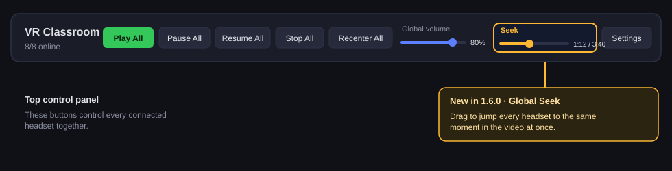
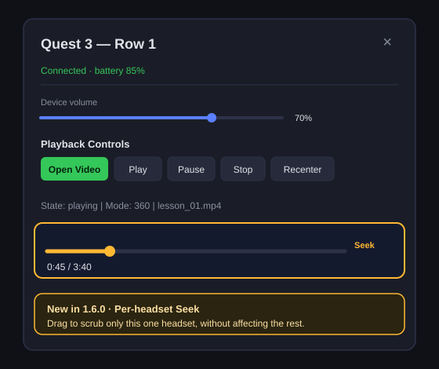

# Щоденне використання

## Ціль

Провести звичайне заняття через панель керування.

## Перед уроком

1. Увімкніть усі гарнітури.
2. Відкрийте player app на кожній гарнітурі.
3. Переконайтеся, що всі пристрої підключені до однієї мережі.
4. Відкрийте панель керування.
5. Переконайтеся, що кожен пристрій показується як online.

## Номери / імена гарнітур

Кожній гарнітурі можна дати номер або ім'я (наприклад, `1`, `2`, … або `Ряд 1 ліворуч`).
Плитки на dashboard завжди відсортовані за цим іменем (`2` йде перед `10`), і порядок не
змінюється, коли гарнітура тимчасово зникає з мережі.

1. Натисніть на плитку гарнітури, а потім на її назву (або кнопку **Перейменувати**).
2. Введіть номер чи ім'я та натисніть Enter.
3. Ім'я **зберігається в самих окулярах** і показується на їхньому HUD у верхньому лівому куті,
   коли відео не відтворюється — так гарнітуру легко впізнати, просто зазирнувши в неї.
4. Поки окуляри не підтвердили збереження, біля назви на плитці показується ⏳. Якщо гарнітура
   офлайн, ім'я буде надіслано автоматично при наступному підключенні.

Оскільки ім'я живе в окулярах, воно не губиться при перевстановленні панелі керування чи
зміні ID пристрою. Зірочка `*` біля назви означає, що плеєр на гарнітурі застарілий і ім'я
зберігається лише на сервері — оновіть плеєр.

## Запуск уроку

1. Відкрийте dashboard.
2. Оберіть навчальне відео, яке потрібно запустити.
3. Перевірте, що потрібне ім'я файлу доступне на підключених гарнітурах.
4. Запустіть відтворення для всіх пристроїв або для однієї обраної гарнітури.

## Під час відтворення

Через панель керування можна:

- відтворювати
- ставити на паузу
- зупиняти
- перезапускати поточне відео
- центрирувати вид
- задавати global volume
- окремо змінювати гучність однієї гарнітури
- **перемотувати (переходити до будь-якого моменту відео)** — нове у 1.6.0

## Перемотка відео (нове у 1.6.0)

Тепер можна перевести відтворення до будь-якої точки відео — наприклад, пропустити вступ або повторити сцену — без перезапуску.

### Для всіх гарнітур одразу

Скористайтеся повзунком **Seek** у верхній панелі керування. Перетягування переводить усі підключені гарнітури до одного моменту, тож увесь клас залишається синхронним.

### Лише для однієї гарнітури

Відкрийте окрему гарнітуру (натисніть на її плитку) і скористайтеся повзунком **Seek** у вікні пристрою. Це перемотує лише цю гарнітуру, не зачіпаючи інші — зручно, якщо одному учню треба наздогнати.

> Повзунок сам слідує за відтворенням і показує поточний час та загальну тривалість (наприклад `1:12 / 3:40`). Він неактивний, доки відео не відкрите і його тривалість невідома.

## Recenter

Використовуйте recenter, якщо учні більше не дивляться в правильному напрямку. Це особливо корисно для 360-контенту або після того, як гарнітуру переміщували.

## Після уроку

1. Зупиніть відтворення.
2. Завершіть сесію або залиште player готовим для наступної групи.
3. Поставте гарнітури на зарядку, якщо батарея низька.
4. Оновлюйте відео лише якщо імена файлів залишаються узгодженими з налаштуваннями панелі.

## Очікуваний результат

Викладач або адміністратор лабораторії має мати можливість керувати всім заняттям без ручного налаштування кожної гарнітури окремо.
