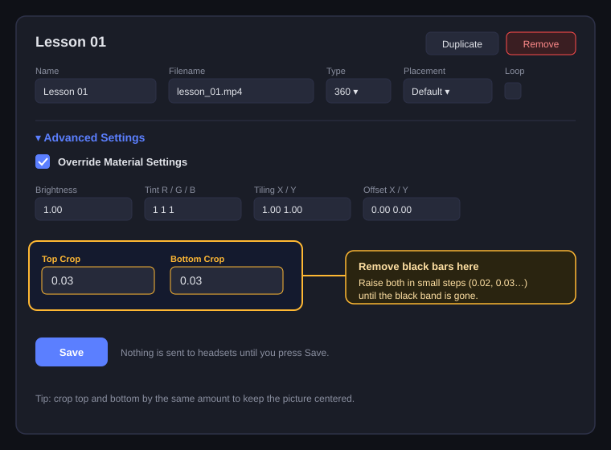
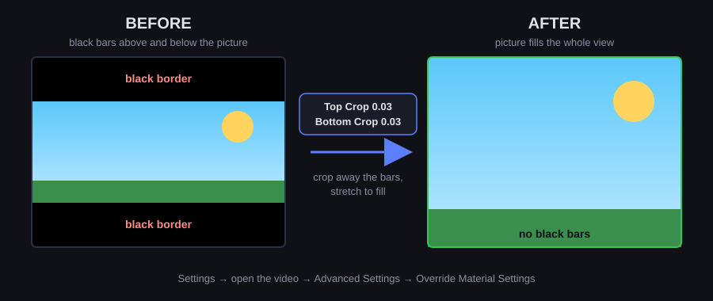

# Налаштування та тюнінг відео

Як користуватися сторінкою **Налаштування** у панелі керування та як зробити, щоб відео уроку виглядало правильно в окулярах — включно з прибиранням чорних смуг через обрізку і розтягування зображення.

## Як відкрити налаштування

1. Відкрийте панель керування у браузері (`http://localhost:8000`).
2. Натисніть **Налаштування** у верхній панелі.
3. Змініть потрібне та натисніть **Зберегти зміни** (угорі праворуч).

> Нічого не застосовується до окулярів, доки ви не натиснете **Зберегти зміни**. Помилки й підтвердження з'являються в правому нижньому куті.

## Розділи налаштувань

Меню ліворуч переходить до кожного розділу:

| Розділ | Що керує |
|---|---|
| **Оновлення** | Версії, останній реліз на GitHub і оновлення в один клік — див. [Оновлення](updates.md) |
| **Загальні** | Мова інтерфейсу |
| **Імпорт / експорт** | Резервна копія і перенесення конфігурації та назв окулярів |
| **Відео уроку** | Список відео уроку, їх тип, розміщення, повтор і тюнінг для кожного відео |
| **Система** | Попередження про батарею, мережа, папка з відео, APK плеєра, системні налаштування окулярів, автозапуск |
| **Оточення в окулярах** | Вигляд кімнати очікування в окулярах |

---

## Загальні

- **Мова** — перемикає інтерфейс між українською та англійською. Застосовується одразу, лише в цьому браузері.

## Імпорт / експорт

- **Експорт config / Експорт назв пристроїв** — завантажує `config.json` / `device_names.json` як резервну копію.
- **Імпорт config / Імпорт назв пристроїв** — завантажує раніше експортований файл. Імпорт **повністю замінює** поточні дані, тому спершу зробіть експорт.

> Робіть експорт перед кожним заняттям як швидку резервну копію, а імпорт — щоб перенести налаштування на інший комп'ютер. Назви, які повідомляють самі окуляри, завжди мають перевагу над імпортованими.

---

## Відео уроку

Кожен урок — це один рядок. Натисніть **Додати відео**, щоб додати новий, **Дублювати**, щоб скопіювати наявне налаштування, або **Видалити**, щоб прибрати.

### Основні поля

| Поле | Значення |
|---|---|
| **Name** | Назва на ваш вибір (напр. `Lesson 01`). Має бути унікальною. |
| **Filename** | Точне ім'я файлу на гарнітурі, напр. `lesson_01.mp4`. **Тільки** ім'я файлу — плеєр відкриває його з `/sdcard/Movies/`. |
| **Type** | `360` для equirectangular 360-відео, `2D` для звичайного плоского відео на віртуальному екрані. |
| **Placement** | Де знаходиться зображення: **Default**, **Locked to camera** (слідує за головою) або **Free in space** (зафіксоване в кімнаті). Старі версії плеєра це ігнорують. |
| **Loop** | Автоматично перезапускати відео після завершення. |

> Назви та імена файлів мають бути унікальними у списку, інакше Save заблокується з попередженням про дублікат.

---

## Тюнінг відео (Advanced Settings)

Відкрийте панель **Advanced Settings** всередині рядка відео, щоб точно налаштувати відображення зображення. Є дві незалежні групи перевизначень — кожна діє лише коли увімкнено її прапорець.

### Override Material Settings — вигляд зображення

Увімкніть **Override Material Settings**, щоб керувати тим, як малюється текстура відео.

| Параметр | Діапазон | Ефект |
|---|---|---|
| **Top Crop** | 0 – 0.49 | Відрізає частку **зверху** кадру та розтягує решту, щоб заповнити. |
| **Bottom Crop** | 0 – 0.49 | Відрізає частку **знизу** кадру та розтягує решту, щоб заповнити. |
| **Brightness** | 0 – 2 | Темніше нижче 1, яскравіше вище 1 (1 = оригінал). |
| **Tint R / G / B / A** | 0 – 1 | Множник кольору. Залиште 1,1,1,1 для природного кольору. |
| **Tiling X / Y** | будь-яке | Масштаб текстури. Нижче 1 — наближення, вище 1 — віддалення/повтор. |
| **Offset X / Y** | будь-яке | Зсуває текстуру по горизонталі/вертикалі. Використовуйте разом з Tiling для перекадрування. |

### Override Transform Settings — геометрія зображення

Увімкніть **Override Transform Settings**, щоб перемістити, повернути або розтягнути всю поверхню відео (найкорисніше для **2D** екранів і розміщення **Free in space**).

| Параметр | Ефект |
|---|---|
| **Position X / Y / Z** | Переміщує екран ліворуч/праворуч, вгору/вниз, ближче/далі. |
| **Rotation X / Y / Z** | Нахиляє/повертає екран (у градусах). |
| **Scale X / Y / Z** | Розтягує екран. Змінюйте **Scale X** проти **Scale Y**, щоб змінити співвідношення сторін / заповнення. |

---

## Як прибрати чорні смуги

Чорні смуги (letterbox) виникають, коли у файлі відео зверху і знизу «вшиті» чорні ділянки (або співвідношення сторін не збігається з екраном). Є два способи виправити це, залежно від типу відео.

### Спосіб 1 — Обрізати і розтягнути (найкраще для 360 і більшості випадків)

Використовуйте, коли чорні смуги є **частиною зображення відео** (letterbox зверху/знизу).

1. Відкрийте рядок відео → **Advanced Settings**.
2. Увімкніть **Override Material Settings**.
3. Збільшуйте **Top Crop** і **Bottom Crop** маленькими кроками (напр. `0.02`, потім `0.03`…).
   - Обрізана смуга прибирається, а решта зображення **розтягується, щоб заповнити**, тож чорні смуги зникають.
4. Збережіть (Save), відкрийте відео на одній гарнітурі та перевірте.
5. Коригуйте, доки чорна смуга не зникне, не обрізаючи важливий вміст.

**Типові стартові значення:** `Top Crop = 0.03`, `Bottom Crop = 0.03`. Обидва максимум `0.49` (більше половини обрізати не можна).

> Порада: обрізайте верх і низ на однакову величину, щоб зберегти вертикальне центрування. Різні значення — лише якщо смуга з одного боку більша.

### Спосіб 2 — Змінити масштаб поверхні (2D екрани)

Використовуйте, коли **плоске 2D** відео не заповнює віртуальний екран або виглядає стиснутим/розтягнутим.

1. Відкрийте рядок відео → **Advanced Settings**.
2. Увімкніть **Override Transform Settings**.
3. Налаштуйте **Scale X** і **Scale Y** під реальне співвідношення сторін відео, щоб заповнити кадр.
   - Розширити зображення: збільште **Scale X**.
   - Зробити вищим: збільште **Scale Y**.
4. За потреби використайте **Position Z**, щоб наблизити або віддалити екран.
5. Збережіть і перевірте на гарнітурі.

### Спосіб 3 — Наближення через Tiling / Offset (тонке кадрування)

Для м'якого ефекту «наблизити за межі смуг» без обрізання:

1. Увімкніть **Override Material Settings**.
2. Задайте **Tiling X/Y** трохи менше `1` (напр. `0.95`), щоб наблизити центр.
3. Використайте **Offset X/Y**, щоб перецентрувати видиме.
4. Збережіть і перевірте.

---

## Рекомендований процес тюнінгу

1. Спершу додайте відео з правильним **Type** (360 або 2D).
2. Протестуйте його **один раз** зі стандартними налаштуваннями на одній гарнітурі.
3. Лише за потреби відкрийте **Advanced Settings** і увімкніть відповідне перевизначення.
4. Змінюйте значення **маленькими кроками**, зберігайте і повторно відкривайте відео, щоб побачити результат.
5. Коли вигляд правильний, використайте **Duplicate** для інших уроків, що потребують того ж тюнінгу.
6. Зробіть **Export Config**, щоб зберегти налаштований набір.

> Advanced Settings зберігаються окремо для кожного відео, тож різні уроки можуть мати різні значення crop/scale.

---

## Система

| Налаштування | Призначення |
|---|---|
| **Поріг попередження батареї (%)** | Підсвічує окуляри з зарядом нижче цього рівня (за замовч. 20). |
| **Інтервал сканування мережі (секунди)** | Як часто панель шукає окуляри в мережі (5–300). Окуляри також знаходять панель самі. |
| **Підмережа** | Задати підмережу, напр. `192.168.1` (перші три числа). Залиште порожнім для автовизначення. |
| **Таймаут офлайн-пристрою (секунди)** | Скільки окуляри можуть «мовчати», перш ніж їх позначать офлайн (10–300, за замовч. 30). |
| **Шлях до APK плеєра** | APK на цьому ПК для **Оновити плеєри**. Окуляри завантажують його по Wi-Fi і тихо встановлюють; ті, де він уже є, пропускають. **Налаштування → Оновлення** заповнює його, коли завантажує реліз. |
| **Папка з відео (бібліотека)** | Папка на цьому ПК з відео уроку. **Синхронізувати відео** надсилає з неї відео зі списку на окуляри по Wi-Fi (плеєр 1.9.0+). |
| **Системні налаштування окулярів** | Одне налаштування Android на рядок: `global/<key>=<value>` або `secure/<key>=<value>`. Кожні окуляри застосовують їх при підключенні; видалений рядок повертає власне значення окулярів. За замовч.: `global/captive_portal_mode=0`. Потрібне одноразове налаштування через Deploy Manager. |

Кнопки: **Оновити плеєри**, **Вимкнути автозапуск**, **Увімкнути автозапуск** (весь клас).

---

## Оточення в окулярах

Що показують окуляри, поки відео не грає (плеєр 1.9.1+):

- **Стандартне** — модель логотипа на бордовому небі.
- **Своє оточення** — колір фону і за бажанням PNG-зображення (до 4096×4096) замість моделі, з його положенням, розміром і поворотом перед глядачем.

Колір і розміщення надсилаються, коли ви натискаєте **Зберегти зміни**; зображення — щойно воно завантажене. **Скинути до стандартного оточення** повертає стандартний вигляд на всіх окулярах.

---

## Пов'язані гайди

- [Підготовка відео](prepare-videos.md)
- [Щоденне використання](daily-use.md)
- [Налаштування панелі керування](setup-control-panel.md)
- [Оновлення](updates.md)
- [Мережа та усунення проблем](networking-troubleshooting.md)
